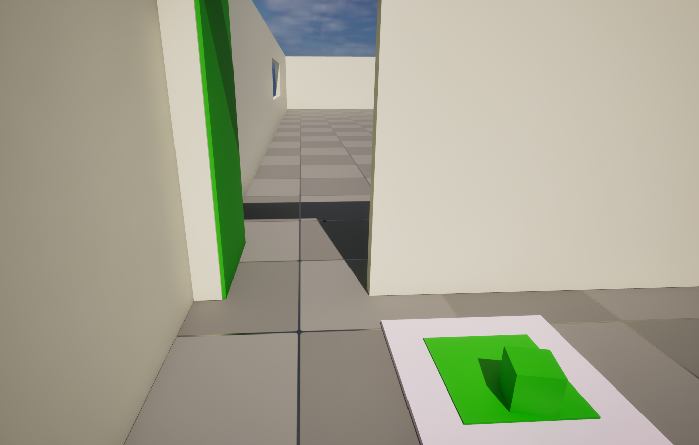
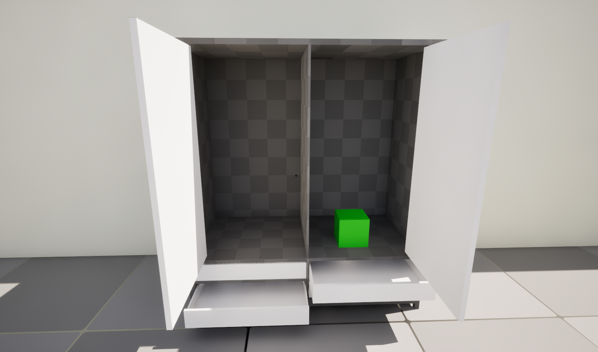
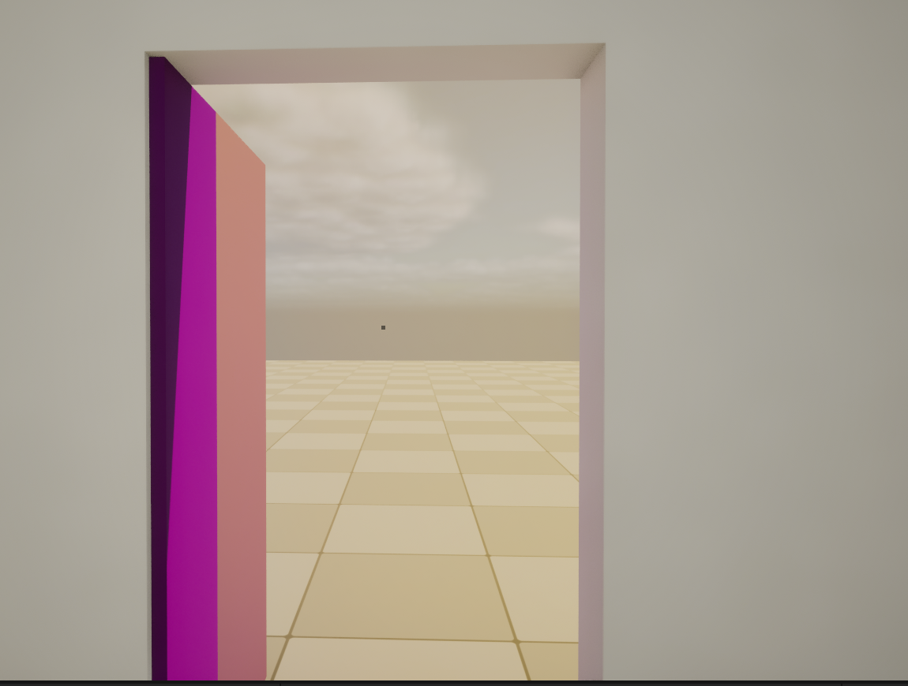
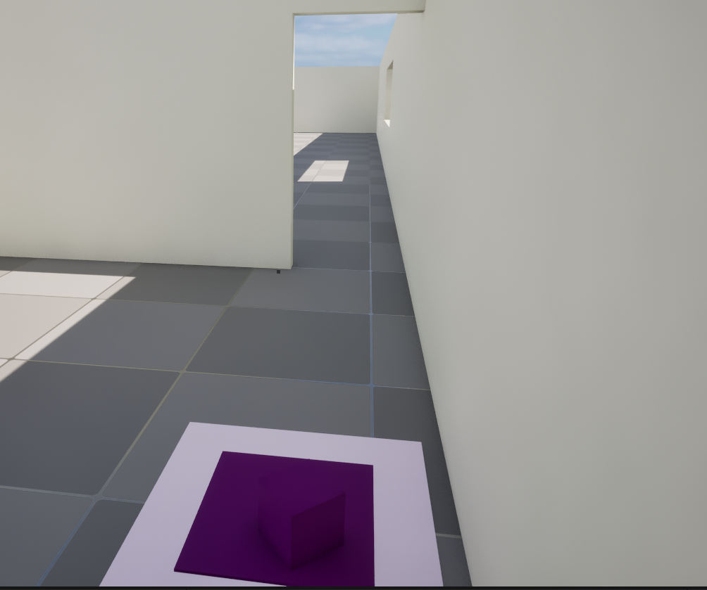

# Locked Doors — Gameplay Systems Prototype

**Unreal Engine 5.4 | Blueprints | First-person interaction and environmental puzzles**

This coursework prototype establishes the foundational gameplay mechanics for **Locked Doors**, a larger puzzle-game concept. It is a functional proof of concept, **not a completed release of the full game**.

## Project overview

The prototype explores how a player can interact with an environment through reusable Blueprint systems. It includes a playable level, interactive objects, puzzle components, a HUD, and menu assets.

### Implemented systems

- First-person player movement and interaction inputs
- Blueprint interaction interface for interactable actors
- Interactive doors, cabinet doors, drawers, and buttons
- Physics-based object pickup
- Puzzle pieces, shortcuts, and an end-game trigger
- HUD crosshair and main-menu widget

## Prototype presentation

The level intentionally uses simple blockout geometry, contrasting colors, and repeated puzzle elements to demonstrate reusable gameplay mechanics. This is a **systems prototype**, not a visually polished or content-complete game.

## Gameplay screenshots

The following screenshots show distinct mechanics from the prototype rather than every variation of the repeated puzzle setups.

### Pressure plate and door

### Interactive cabinet and drawers

### Open doorway

### Alternate puzzle station

## Tools and demonstrated skills

| Tools | Skills demonstrated |
| --- | --- |
| Unreal Engine 5.4 | Gameplay prototyping and level implementation |
| Blueprints | Event-driven gameplay logic and reusable interactions |
| Unreal Engine Modeling Tools | Basic environment and object construction |
| Git and GitHub | Branching, merges, source control, and project preparation |

## Open and test

1. Install **Unreal Engine 5.4**.
2. Clone or download this repository.
3. Open `MyProject.uproject`.
4. Open the `FinalProject` level if it does not load automatically.
5. Use **Play In Editor** to explore the interaction and puzzle mechanics.

The author has tested the clean portfolio copy in Unreal Engine 5.4 and confirmed that the project opens and that the primary interaction, puzzle, HUD, and menu features work.

## Development and learning

The project began as a technical foundation for a more ambitious *Locked Doors* concept. The coursework focused on building working gameplay systems rather than completing the full game.

One significant challenge was learning the Git branch workflow. After merging feature branches remotely, I initially did not realize that my local main branch also needed to be pulled to receive those changes. This made work appear to have disappeared even though it was preserved on GitHub. Resolving that misunderstanding improved my understanding of branching and synchronization.

Course feedback mainly addressed the larger game idea and the GitHub workflow difficulties. **No post-coursework gameplay redesign is claimed.** For portfolio presentation, I prepared a separate repository with a clean history and clearer documentation, while preserving the original school repository privately.

## Scope and attribution

This is an educational gameplay prototype, not a commercial release. Project-specific Blueprint systems, interactions, and level work were created as coursework by Ryan Mills. Unreal Engine and any engine-provided assets remain subject to Epic Games' applicable terms. No rights to third-party assets are granted by this repository.

**Publication status:** This repository is intentionally private pending final review of any applicable asset-redistribution and course-specific restrictions.
